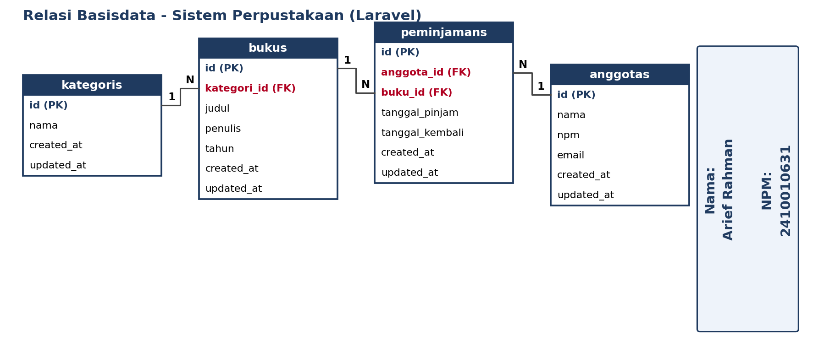

# Laravel Perpustakaan

Nama : ARIEF_RAHMAN
NPM  : 2410010631

## Gambar Relasi Basisdata



URL gambar: https://github.com/USERNAME/NAMA-REPO/blob/main/gambar_relasi.png

## Relasi
- `kategoris` 1 - N `bukus`
- `bukus` 1 - N `peminjamans`
- `anggotas` 1 - N `peminjamans`

## Menjalankan
```bash
composer install
cp .env.example .env
php artisan key:generate
# atur DB di .env (atau pakai sqlite)
php artisan migrate --seed
php artisan serve
```
Buka http://127.0.0.1:8000
